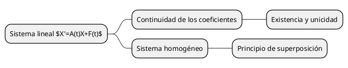

# Pegado de texto y árboles

Ctrl+V sobre el lienzo crea un elemento Texto cuando el portapapeles contiene texto común. El menú contextual «Pegar» también permite insertar texto. El pegado dentro de un campo de edición sigue perteneciendo a ese campo.

Los objetos propios copiados, enlaces, YouTube, archivos, imágenes, SVG y tablas conservan sus rutas anteriores. Si aparece una URL en cualquier parte del texto, no se interpreta como mindmap ni como KaTeX.

## Árboles de implicaciones

Se admite este subconjunto local de [PlantUML MindMap](https://plantuml.com/mindmap-diagram):

También se puede copiar una cerca de código completa. Se requiere una raíz, sin saltos de nivel, con hasta 127 nodos, 24 niveles y 2000 caracteres por etiqueta. No se interpretan estilos, inclusiones, directivas ni otras familias de diagramas. Una entrada inválida se pega íntegra como texto y muestra un aviso.

Al pegar, el motor oficial `@plantuml/core` (MIT, versión 1.2026.6) distribuye el mapa con ramas curvas y se genera **una sola imagen PNG** con fondo blanco. Se puede mover, redimensionar, guardar y deshacer como cualquier imagen. Las fórmulas con `$…$`, `$$…$$`, `\(...\)`, `\[...\]` y `<latex>…</latex>` se renderizan con KaTeX dentro del PNG. Cada expresión ocupa una línea propia, separada del texto, incluso cuando se escribe en línea con `$…$`. Una fórmula inválida conserva su fuente legible.

PlantUML se carga al pegar el primer mapa y se ejecuta en el navegador, sin Java ni servidores externos. Sus recursos también forman parte de la caché de la aplicación para trabajar sin conexión. Si falla la generación, se conserva el mapa como texto y se muestra un aviso. El importador no crea objetos por nodo ni conserva un editor de mapas: solo guarda el PNG final.

## Edición y fórmulas

Doble clic muestra la fuente de texto sobre el elemento, ocultando su etiqueta dibujada. Enter agrega una línea; Escape o tocar fuera guarda. La posición del editor respeta el zoom y la rotación de la figura.

Textos y etiquetas de figuras sin URL muestran fórmulas con `$…$`, `$$…$$`, `\(...\)` y `\[...\]`; las figuras también admiten `<latex>…</latex>`. Se conserva la fuente y las fórmulas inválidas permanecen legibles. No se convierte automáticamente notación matemática sin delimitadores.

El render utiliza KaTeX existente, con `trust: false`, y rasterización serializada con `html-to-image`. Una caché en memoria limita las representaciones a 256 entradas y 16 millones de píxeles; el zoom y el desplazamiento no invalidan las entradas. Si no puede generar una imagen o se excede el presupuesto de imágenes, se mantiene el texto fuente. Las exportaciones preparan las fórmulas antes de pintar y liberan la retención temporal al terminar.

## Verificación en CI

El workflow `checks.yml` admite `workflow_dispatch` con `focus: pizarra-text`. Compila la pizarra y ejecuta exclusivamente las pruebas del importador y los escenarios de pegado/edición con un trabajador de navegador. Publica capturas y diagnósticos. Los casos también están incluidos en las comprobaciones habituales. No requiere ejecutar compilaciones o navegadores localmente.
